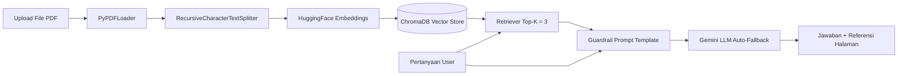

# 📄 Smart Document Q&A (RAG Pipeline)

Asisten tanya jawab dokumen berbasis **Retrieval-Augmented Generation (RAG)** yang dibangun menggunakan **Python**, **LangChain**, **ChromaDB**, **HuggingFace Embeddings**, **Google Gemini API**, dan **Streamlit**. 

Aplikasi ini memungkinkan pengguna mengunggah dokumen PDF (seperti SOP teknis, jurnal penelitian, atau dokumentasi sistem) dan mengajukan pertanyaan spesifik dalam bahasa natural. Setiap jawaban dihasilkan secara ketat berdasarkan isi dokumen dan dilengkapi dengan **kutipan sumber beserta nomor halaman** (*Source Citation*) untuk mencegah halusinasi AI.

---

## 🎯 Latar Belakang & Solusi

Large Language Model (LLM) standar memiliki dua keterbatasan utama saat digunakan untuk kebutuhan dokumen privat:
1. **Tidak memiliki akses ke data spesifik/internal** yang tidak ada di data latih publiknya.
2. **Rentan berhalusinasi** (mengarang jawaban yang terdengar meyakinkan ketika informasi tidak ditemukan).

Proyek ini menyelesaikan masalah tersebut dengan menerapkan arsitektur **RAG** yang menggabungkan pencarian semantik berbasis vektor (*Vector Similarity Search*) dengan *Guardrail Prompting* sehingga model hanya menjawab berdasarkan fakta yang tertulis di dokumen.

---

## ✨ Fitur Utama

- **Dynamic PDF Ingestion & Chunking:** Mengekstrak teks per halaman menggunakan `PyPDFLoader` dan memecahnya secara cerdas menggunakan `RecursiveCharacterTextSplitter` (`chunk_size=1000`, `chunk_overlap=200`) agar konteks antar-kalimat tetap utuh.
- **Local Embedding Model with Disk Caching:** Menggunakan model `sentence-transformers/all-MiniLM-L6-v2` secara lokal dengan mekanisme `@st.cache_resource` dan `local_files_only=True` sehingga proses *embedding* berjalan cepat, gratis, dan tanpa batas kuota API.
- **In-Memory Vector Search (ChromaDB):** Menyimpan indeks vektor di dalam `st.session_state` untuk pengambilan konteks paling relevan (*Top-K = 3*) secara instan selama sesi tanya jawab berlangsung.
- **Multi-Model Auto-Fallback:** Dilengkapi mekanisme *fallback* berantai pada pemanggilan LLM (`gemini-3.8-flash` → `gemini-3.6-flash` → `gemini-3.5-flash-lite`) dengan batas waktu (*timeout*) terkontrol untuk menjaga ketersediaan layanan saat server mengalami lonjakan trafik (`503 UNAVAILABLE`).
- **Anti-Hallucination Guardrail Prompt:** Instruksi sistem ketat yang memaksa LLM menolak menjawab secara jujur apabila informasi yang ditanyakan tidak tersedia di dalam dokumen.
- **Transparent Source Citation:** Menyediakan panel *expander* interaktif yang menampilkan potongan teks asli (*chunks*) dan nomor halaman rujukan yang digunakan AI untuk menyusun jawaban.
- **Windows TLS/SSL Resilience:** Konfigurasi eksplisit `certifi` untuk memastikan validasi sertifikat TLS pada klien HTTP berjalan stabil di lingkungan Windows.

---

## 🏗️ Arsitektur Sistem

### 1. Alur Utama (Code-First Pipeline: Streamlit + LangChain)



**Tahapan Kerja Pipeline:**
1. **Indexing Phase:** Dokumen PDF yang diunggah dibaca per halaman, dipecah menjadi potongan teks (*chunks*), dikonversi menjadi vektor numerik berdimensi 384 menggunakan `all-MiniLM-L6-v2`, lalu disimpan ke dalam **ChromaDB**.
2. **Retrieval Phase:** Pertanyaan pengguna dikonversi menjadi vektor dan dicocokkan dengan indeks di ChromaDB untuk mengambil 3 potongan teks paling relevan (`k=3`).
3. **Augmented Generation Phase:** Potongan teks relevan digabungkan ke dalam *prompt template* anti-halusinasi bersama pertanyaan pengguna, lalu dikirim ke model Google Gemini untuk menghasilkan jawaban faktual yang dilengkapi dengan kutipan referensi dan nomor halaman.

---

## 📁 Struktur Direktori

```text
smart-doc-rag/
├── sample_docs/            # Folder untuk menyimpan contoh dokumen PDF uji coba
│   ├── .gitkeep
│   └── README.md
├── .env.example            # Template konfigurasi environment variable
├── .gitignore              # Daftar berkas & folder yang diabaikan oleh Git
├── app.py                  # Skrip utama aplikasi Streamlit & alur RAG
├── README.md               # Dokumentasi lengkap proyek
└── requirements.txt        # Daftar pustaka/dependensi Python
```

---

## 🚀 Panduan Memulai

### 1. Prasyarat Sistem
- **Python 3.10** atau versi lebih baru
- API Key Google Gemini (dapatkan gratis di [Google AI Studio](https://aistudio.google.com/app/apikey))

### 2. Kloning Repository
```bash
git clone https://github.com/<username-anda>/smart-doc-rag.git
cd smart-doc-rag
```

### 3. Buat dan Aktifkan Virtual Environment
- **Windows (PowerShell):**
  ```powershell
  python -m venv venv
  .\venv\Scripts\Activate.ps1
  ```
- **Linux / macOS:**
  ```bash
  python3 -m venv venv
  source venv/bin/activate
  ```

### 4. Pasang Dependensi
```bash
pip install -r requirements.txt
```

### 5. Konfigurasi Environment Variables
Salin file `.env.example` menjadi `.env`:
- **Windows (PowerShell):**
  ```powershell
  Copy-Item .env.example .env
  ```
- **Linux / macOS:**
  ```bash
  cp .env.example .env
  ```

Buka `.env` dan masukkan API Key Google Gemini Anda:
```env
GOOGLE_API_KEY="AIzaSyYourSecretKeyHere..."
```

### 6. Jalankan Aplikasi
```bash
streamlit run app.py
```
Aplikasi akan terbuka otomatis di browser pada alamat `http://localhost:8501`.

---

## 🌐 Panduan Deployment ke Streamlit Community Cloud (Gratis)

Aplikasi ini dapat di-deploy secara online dan gratis menggunakan **Streamlit Community Cloud** sehingga dapat diakses melalui URL publik dari perangkat mana saja:

### 1. Masuk ke Streamlit Cloud
1. Buka [share.streamlit.io](https://share.streamlit.io/).
2. Masuk menggunakan akun GitHub Anda (**Continue with GitHub**).

### 2. Buat Aplikasi Baru
1. Klik tombol **"Create app"** (atau **"New app"**).
2. Tentukan parameter berikut:
   - **Repository:** `<username-anda>/smart-doc-rag`
   - **Branch:** `main`
   - **Main file path:** `app.py`
   - **App URL:** *(Opsional)* Tentukan nama subdomain yang diinginkan.

### 3. Konfigurasi Secrets (Format TOML)
Karena berkas `.env` **wajib diabaikan** oleh Git demi keamanan agar kunci rahasia tidak bocor ke publik, API Key harus dimasukkan melalui menu **Secrets** di Streamlit Cloud:

1. Klik menu **"Advanced settings..."** (atau buka menu **Settings** $\rightarrow$ **Secrets** jika aplikasi sudah dibuat).
2. Masukkan konfigurasi dalam format **TOML** yang valid (*wajib diapit tanda petik dua*):
   ```toml
   GOOGLE_API_KEY = "your_google_gemini_api_key_here"
   ```
   > ⚠️ **Perhatian Format TOML:** Nilai API Key **wajib** diapit oleh tanda petik dua (`"..."`). Menuliskan nilai tanpa tanda petik akan menyebabkan error *Invalid TOML*.

3. Klik **Save**, lalu klik **Deploy!**.

### 4. Alternatif: Input API Key via Sidebar
Jika Anda tidak ingin mengisi menu Secrets, aplikasi ini telah dilengkapi dengan pendeteksi otomatis di panel samping (**Sidebar**). Pengguna dapat langsung menempelkan API Key Gemini di kolom input pada sidebar saat aplikasi dibuka di peramban web.

---

## 🛠️ Ringkasan Teknologi

| Komponen | Pustaka / Layanan |
| :--- | :--- |
| **Frontend UI** | Streamlit |
| **Framework RAG** | LangChain (`langchain`, `langchain-community`, `langchain-google-genai`, `langchain-huggingface`) |
| **PDF Parsing** | `pypdf` |
| **Vector Database** | ChromaDB |
| **Local Embeddings** | HuggingFace (`sentence-transformers/all-MiniLM-L6-v2`) |
| **LLM Provider** | Google Generative AI (`gemini-3.8-flash`, `gemini-3.6-flash`, `gemini-3.5-flash-lite`) |
| **TLS & Security** | `certifi`, `python-dotenv` |

---

## 🔒 Catatan Keamanan
- Berkas `.env` telah didaftarkan dalam `.gitignore` sehingga tidak akan terunggah ke repositori publik.
- Jangan pernah membagikan atau mengunggah API key pribadi Anda ke internet.
